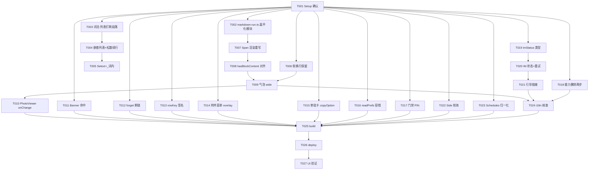

# Tasks: 聊天页与全局移植一致性修复（chat-parity-fix）

**Input**: Design documents from `spec/chat-parity-fix/`（spec.md FR-001~FR-017 / US1~US9；plan.md R1~R18）

**Prerequisites**: plan.md（必需），spec.md（必需，用户故事来源）

**Tests**: 未要求 TDD/自动化测试；验证经 Verification 阶段（build+ui，用户已选择）完成。

**Organization**: 任务按用户故事分组，支持独立实现与独立验证；工程为既有项目增量修复，Setup 极简；执行者为单一实现代理，任务编号即建议执行顺序（同文件任务已排为相邻顺序）。

## Format: `[ID] [P?] [Story] Description`

- **[P]**: 可并行（不同文件、无未完成依赖）
- **[Story]**: 所属用户故事（映射 spec.md US1~US9）
- 任务描述含确切文件路径

## Path Conventions

- **单工程**：`entry/src/main/ets/` 为源码根（ArkTS 工程，HarmonyOS API 26）
- 文中路径均相对 `E:\Dshbot\DSHBot-Harmony\`（如 `entry/src/main/ets/screens/chat/MarkdownText.ets`）
- 规格文档位于 `spec/chat-parity-fix/`（spec.md / plan.md / tasks.md 三件）
- 无 `tests/` 目录（未要求自动化测试）

---

## Phase 1: Setup (Shared Infrastructure)

**Purpose**: 确认工程上下文与规格就绪。

- [X] T001 确认工程上下文就绪：`entry/build-profile.json5` 与 `oh-package.json5` 存在、规格三件（spec.md/plan.md/tasks.md）已读入；本次为既有工程修复，无脚手架需求

---

## Phase 2: Foundational (Blocking Prerequisites)

**Purpose**: US1 渲染重写依赖的行内扁平化纯函数模块（其余用户故事不依赖本阶段，可先行）。

**⚠️ CRITICAL**: T002 完成前 T007（Span 渲染重写）不可开始。

- [X] T002 [P] 新建行内样式扁平化纯函数模块：`StyledRun` 接口（text/bold/italic/strike/mono/href/muted）与 `flattenInlineRuns`（先序遍历、INLINE_DEPTH=6 超限降纯文本不丢字、codespan 字面内容+两侧 CJK hair-space 上下文、br 产 `'\n'` 段、image 产 muted alt 段、link 携 href、escape 归并文本），文件 `entry/src/main/ets/common/markdown/markdown-run.ts`（决策依据 plan.md R1；不改既有 markdown.ts/markdown-model.ts 的导出）

**Checkpoint**: 纯数据层就绪，US1 渲染重写可以开始。

---

## Phase 3: User Story 1 - 聊天消息的行内样式与结构完整可见 (Priority: P1) 🎯 MVP

**Goal**: 用户报告的加粗不可见主缺陷（FR-001）及词法/软换行/气泡宽（FR-002/003/004）全部修复；US1 验收场景 1~7 通过。

**Independent Test**: 聊天页查看含 `**加粗**`/`*斜体*`/`~~删除~~`/链接/列表/嵌套列表/多行/`my_var_name`/Setext/代码块的消息，逐项比对 SC-001；点链接验证跳转。

### Implementation for User Story 1

- [X] T003 [P] [US1] FR-002 词法规则一（列表打断段落）：lexBlocks 段落收集循环增加 break 条件——无序列表标记行恒打断、有序列表标记行仅起始数字为 1 时打断（对齐 marked；注意与 hr/表格分隔行正则不冲突），文件 `entry/src/main/ets/common/markdown/markdown.ts`（plan.md R2-1）
- [X] T004 [US1] FR-002 词法规则二/三（嵌套列表保层级 + 松散空行续行）：列表项续行处理中，续行本身是列表标记行且缩进 ≥ 内容列时只剥离"标记列"缩进（itemIndent）使其在递归 lexBlocks 中成为嵌套 list；空行后跟缩进 ≥ 内容列的任意非空续行时并入项体（bodyLines 置空行续收），文件 `entry/src/main/ets/common/markdown/markdown.ts`（plan.md R2-2/2-3；依赖 T003 同文件顺序执行）
- [X] T005 [US1] FR-002 词法规则四/五（Setext 标题 + `_` 词内限制）：段落循环识别 `^ {0,3}=+\s*$`（depth 1）/`^ {0,3}-{2,}\s*$`（depth 2）下划线行并输出 heading（与 hr/列表正则互斥）；lexInline 中 `_` 的 strong/em 增加简化侧翼检查（开标记前字符为字母数字不开启、闭标记后字符为字母数字不闭合；`*` 与 CJK 锚点行为不变）；同步修正 markdown.ts:292 附近"soft break collapses"的过时注释，文件 `entry/src/main/ets/common/markdown/markdown.ts`（plan.md R2-4/2-5；依赖 T004）
- [X] T006 [P] [US1] FR-003 软换行保留：`normalizeSoftBreaks` 改为原样保留 `\n`（不再折叠为空格），调用点（MarkdownText.ets 210/464/471）签名不变；修正 `markdown-model.ts` 与 `markdown-rules.ts` 头注中"soft break collapses"表述（`softBreakText` 无调用点、签名不动），文件 `entry/src/main/ets/common/markdown/markdown-model.ts`、`entry/src/main/ets/common/markdown/markdown-rules.ts`（plan.md R3）
- [X] T007 [US1] FR-001 行内样式 Span 渲染重写：`MarkdownInlines.runs` 由嵌套 Text 改为消费 `flattenInlineRuns` 输出的 Span 序列——strong→fontWeight 600、em→FontStyle.Italic、del→decoration LineThrough、codespan→MONO 字族+fontSize `max(12.5, fs-2.5)`、link→accent 色+Underline+onClick（openExternalUrl，仅 http/https/mailto，其余降纯文本）、br/image/文本段按 R1 映射；样式标志可叠加（粗+斜+删除线等）；copyOption 保留，文件 `entry/src/main/ets/screens/chat/MarkdownText.ets`（plan.md R1；依赖 T002）
- [X] T008 [US1] FR-004 hasBlockContent 对齐 RN：移除"段落含被提升图片"分支，仅统计非 paragraph/text/space 块（RN markdown.tsx:25-27 语义），文件 `entry/src/main/ets/screens/chat/MarkdownText.ets`（plan.md R4；依赖 T007 同文件顺序执行）
- [X] T009 [US1] FR-004 气泡 wide 宽度：userBubble `wide = hasBlockContent(text)`、botBubbleRow `wide = bodyTexts.some(hasBlockContent) || hasImages`，wide 时气泡宽度取 maxWidth（@Builder if/else 双分支共享内容子 Builder，不用 width(undefined) 写法）；群聊 botRow part 气泡（1293 行附近）alignSelf Stretch 条件补为 `hasBlockContent(partText) || (last && hasImages)`；photosOnly 透明逻辑不变，文件 `entry/src/main/ets/screens/chat/ChatRows.ets`（plan.md R4；依赖 T006+T008）

**Checkpoint**: US1 全部验收场景（加粗/斜体/删除线/链接/列表/嵌套/换行/下划线标识符/Setext/wide 气泡）应可独立通过。

---

## Phase 4: User Story 2 - 图片查看器翻页正常 (Priority: P1)

**Goal**: 多图查看器翻页时页码更新、原图加载（FR-005）。

**Independent Test**: 打开 3 图消息的查看器，滑到第 3 张，页码显示 3 / 3 且清晰原图随后加载。

- [X] T010 [US2] FR-005 PhotoViewer Swiper 补 `.onChange((index) => { this.at = index })`（`at` 已驱动页码 348 行与 PhotoPage active 原图加载），文件 `entry/src/main/ets/screens/chat/ChatRows.ets`（plan.md R5；依赖 T009 同文件顺序执行）

---

## Phase 5: User Story 3 - 顶部通知横幅可点击跳转 (Priority: P1)

**Goal**: 横幅点击可达并跳转对应聊天（FR-006）。

**Independent Test**: 触发 question/approval 通知，横幅显示期间点击文字区域，跳转且横幅消失。

- [X] T011 [P] [US3] FR-006 横幅卡命中：外层 Column 的 `hitTestBehavior(HitTestMode.None)` 保留（区域穿透），横幅卡 Text（带 onClick 节点）补 `hitTestBehavior(HitTestMode.BLOCK_HIERARCHY)`（官方 FAQ faqs-arkui-1052 场景一模式），文件 `entry/src/main/ets/components/Banner.ets`（plan.md R6）

---

## Phase 6: User Story 4 - 忘记电脑后正确断链 (Priority: P1)

**Goal**: 忘记当前活跃电脑后链接切换/关闭正确（FR-007）。

**Independent Test**: 已连接 A（另存 B）忘记 A → 切到 B 并重连；仅存 A 忘记 A → 降级配对引导、无残留链接。

- [X] T012 [P] [US4] FR-007 forget 补断链：`forget()` 在 `await appStore.computers.forget(...)` 与 `await this.load()` 之后补 `appStore.ensureLink()`（与 switchTo 331-334 对齐），文件 `entry/src/main/ets/screens/settings/TeamPages.ets`（plan.md R7）

---

## Phase 7: User Story 5 - 消息行内容变化即时刷新 (Priority: P2)

**Goal**: 行内容变化无需滚动即刷新（FR-008）。

**Independent Test**: 构造消息刷新后补充图片引用的场景，不滚动列表即见图片网格。

- [X] T013 [P] [US5] FR-008 rowKeyOf 内容签名：在既有键缀后追加 `+f${files.length}`、`+i${imageRefs.length + images}`、`+w${whole?1:0}`、`+s${stamp}`、`+l${local??''}`、`+x${(text??'').length}`；基础 key/openSteps/openTools/RowsSource diff 逻辑不动，文件 `entry/src/main/ets/screens/chat/MessageList.ets`（plan.md R8/R18）

---

## Phase 8: User Story 6 - 附件菜单不再撑大输入栏 (Priority: P2)

**Goal**: 双通道附件菜单浮层化，输入栏布局不变（FR-009）。

**Independent Test**: 支持双通道的主机上点 + 打开菜单，输入栏卡片高度与输入行位置不变。

- [X] T014 [P] [US6] FR-009 附件菜单 overlay 化：菜单从 Stack 子组件（ChatInput.ets 422-455）迁至输入行 Row 的 `.overlay(菜单 Builder, { align: Alignment.BottomStart })` 浮层（offset 向上偏移保持视觉位置；样式与 pickPhoto/pickFile/menuOpen 行为不变；Stack 保留仅移除菜单子节点），文件 `entry/src/main/ets/screens/chat/ChatInput.ets`（plan.md R9）

---

## Phase 9: User Story 7 - 可复制文本与门禁可用性 (Priority: P2)

**Goal**: 审批卡可复制（FR-010）、能力删除两步确认（FR-016）、门禁 PIN 回退（FR-013）、prefs 防砖化（FR-012）。

**Independent Test**: 长按审批命令文本可复制；能力删除首拍进入确认态二拍才删；PIN-only 设备门禁行为按平台能力；损坏 prefs 启动回退默认值。

- [X] T015 [P] [US7] FR-010 审批卡可复制：ApprovalCard 卡体三个 Text（approval.detail.text / reason / detail.code）补 `.copyOption(CopyOptions.LocalDevice)`，文件 `entry/src/main/ets/screens/chat/ChatCards.ets`（plan.md R10）
- [X] T016 [P] [US7] FR-012 readPrefs 容错：`JSON.parse` 包 try/catch，失败置 `prefsCache = {}` 并返回，不再抛出，文件 `entry/src/main/ets/common/team/store-core.ts`（plan.md R12）
- [X] T017 [P] [US7] FR-013 门禁 PIN 探测回退：ensureUnlock 探测列表扩为 `[FACE, FINGERPRINT, PIN]`（getAvailableStatus 逐个 try/catch 收集 enrolled 集合），authType 传 enrolled 集合；全无 enrolled 时维持 UnlockError('unlock/unavailable')（此时"未设置锁屏"文案准确）；widgetParam/ATL1/结果回调不变，文件 `entry/src/main/ets/platform/Platform.ets`（plan.md R13）
- [X] T018 [P] [US7] FR-016 能力删除两步确认：展开行 Delete 动作改内联 armed+timer 两步模式（首拍切确认文案并记录 armed id，3s 内二拍执行 capability-delete，超时解除；参照 Schedules.confirmDelete 同型写法），文件 `entry/src/main/ets/screens/settings/CapabilityManager.ets`（plan.md R16）

---

## Phase 10: User Story 8 - IM 状态可见与侧边聊及时刷新 (Priority: P3)

**Goal**: IM 页消费 imStatus 五态 + error 态重试（FR-014）、引导链接可点（FR-015）、侧边聊 answering 期间 1.5s 轮询（FR-011）。

**Independent Test**: IM 连接失败显示错误与「Try again」并重试；引导"打开控制台"链接可点跳转；侧边聊回答约 1.5s 内流式出现。

- [X] T019 [P] [US8] FR-014 类型扩展：`TeamState` 增 `imStatus?: Record<string, ImStatusEntry>`，新增 `ImStatusEntry { state?: string; error?: string; at?: number }`，文件 `entry/src/main/ets/common/team/types.ts`（plan.md R14）
- [X] T020 [US8] FR-014 IM 状态消费与重试：`connStatusLine`（列表行 761 与详情头 986 共用）按桌面 stateOf/stateText 五态语义消费 `appStore.link.team?.imStatus?.[conn.id]`（off→Disabled、ready→Connected、retrying→Retrying…、error→Could not connect: {error}、缺省→Connecting…；enabled===false 恒 Disabled；状态缺失回退现有文案）；详情页 error 态状态区旁加「Try again」按钮调 `controller.call('im-retry', { id })`，文件 `entry/src/main/ets/screens/settings/Im.ets`（plan.md R14；依赖 T019）
- [X] T021 [US8] FR-015 引导链接可点：addBlock 引导步骤下方渲染 `GUIDES[platform].linkLabel`（accent 色+下划线，onClick 经 openExternalUrl 打开 link，限 http/https/mailto；link 空不渲染），文件 `entry/src/main/ets/screens/settings/Im.ets`（plan.md R15；依赖 T020 同文件顺序执行）
- [X] T022 [P] [US8] FR-011 侧边聊轮询启停：`running()` 改 `@Computed`，新增 `@Monitor('running')` 调 `setPolling(running)`（setPolling 本体 114-128 已实现不动；aboutToDisappear 的 setPolling(false) 保留），文件 `entry/src/main/ets/screens/Side.ets`（plan.md R11）

---

## Phase 11: User Story 9 - 定时任务暂停判断修复 (Priority: P3)

**Goal**: pausable 不再因 NaN 恒否（FR-017）。

**Independent Test**: 已过期一次性任务行不显示暂停/恢复控制（demo 与真实 ISO 数据两通路均正确）。

- [X] T023 [P] [US9] FR-017 Schedules 时间归一化：`ScheduleTaskFull.scheduledAt` 类型改 `string | number`；新增归一化（number 直取、string 走 Date.parse）；`pausable()` 用 `Number.isFinite(when) && when <= Date.now()` 判过期不可暂停；`whenText` 经同一归一化喂 `timeLabel`，文件 `entry/src/main/ets/screens/Schedules.ets`（plan.md R17）

---

## Phase 12: Polish & Cross-Cutting Concerns

**Purpose**: 跨故事收尾项。

- [X] T024 i18n 完整性核查：T017~T023 新增/改动的用户可见文案（如能力删除确认态文案、IM 重试按钮「Try again」、Retrying…/Could not connect 等）确认在 `entry/src/main/ets/common/ui/i18n.ts` 词条齐全且中英双语；缺失则补齐并核对调用点传参，文件 `entry/src/main/ets/common/ui/i18n.ts`（依赖 T015~T023 完成）

---

## Phase 13: Verification

<!-- verification_scope: build+ui -->

**Purpose**: 构建、部署并按用户故事 UI 验证（用户在 Phase 3 验证方式门选择「验证 + UI 验证」）。

- [x] T025 构建并修复编译错误（invoke `devecocli build`；iterate fix → build until success；SC-003 要求无新增 ArkTS 静态检查错误）
- [x] T026 部署到本机模拟器 Mate 90 Pro / HarmonyOS 7 / API 26（invoke `devecocli run --skip-build`）
- [ ] T027 按 US1~US9 验收场景逐故事 UI 验证（invoke verify_ui；US1 覆盖 SC-001 加粗场景与验收场景 1~7；SC-004 有意差异项回归抽查：两步确认、返回键开抽屉、待办分类、Draft 切换清空、DeepView 预选行为不变）

---

## Dependencies & Execution Order

### Phase Dependencies

- **Setup (Phase 1)**: 无依赖，立即开始
- **Foundational (Phase 2)**: 依赖 Setup 完成——仅阻塞 T007（US1 渲染重写）；US2~US9 独立任务（T011~T019、T022、T023）不依赖本阶段
- **User Stories (Phase 3+)**: US1 链依赖 T002；其余故事仅依赖 T001，可先行
- **Polish (Phase 12)**: 依赖全部用户故事任务完成（T024 核查所有新增文案）
- **Verification (Phase 13)**: 依赖全部前序任务

### User Story Dependencies

- **User Story 1 (P1)**: T003→T004→T005（markdown.ts 同文件串行）；T007 依赖 T002；T007→T008（MarkdownText.ets 同文件串行）；T009 依赖 T006+T008
- **User Story 2 (P1)**: T010 依赖 T009（ChatRows.ets 同文件串行）
- **User Stories 3~7、9 (P1/P2/P3)**: 各自单文件独立（T011/T012/T013/T014/T015/T016/T017/T018/T023），无跨故事依赖
- **User Story 8 (P3)**: T019（类型）→T020→T021（Im.ets 同文件串行）；T022 独立

### Within Each User Story

- 纯函数/类型层先于渲染/消费层（T002→T007、T019→T020）
- 词法层先于渲染层（T003~T005→T007 消费其输出）
- 同文件任务严格按编号串行（见上）

### Parallel Opportunities

- 11 个 [P] 任务互不同文件可并行：T002、T003、T006、T011、T012、T013、T014、T015、T016、T017、T018、T019、T022、T023
- US2~US9 各故事可独立于 US1 先行交付
- 单代理顺序执行时按任务编号即满足全部同文件约束

### Dependency Graph



---

## Parallel Example: User Story 7 与独立故事

```bash
# US7 四任务 + 其余独立故事任务可同时启动（全部不同文件）:
Task: "T015 [P] [US7] 审批卡 copyOption — entry/src/main/ets/screens/chat/ChatCards.ets"
Task: "T016 [P] [US7] readPrefs 容错 — entry/src/main/ets/common/team/store-core.ts"
Task: "T017 [P] [US7] 门禁 PIN — entry/src/main/ets/platform/Platform.ets"
Task: "T018 [P] [US7] 能力删除两步 — entry/src/main/ets/screens/settings/CapabilityManager.ets"
Task: "T011 [P] [US3] Banner 命中 — entry/src/main/ets/components/Banner.ets"
Task: "T013 [P] [US5] rowKey 签名 — entry/src/main/ets/screens/chat/MessageList.ets"

# 同文件任务必须串行（不可并行）:
# T003 → T004 → T005 (markdown.ts)
# T007 → T008 (MarkdownText.ets)
# T009 → T010 (ChatRows.ets)
# T020 → T021 (Im.ets)
```

---

## Implementation Strategy

### MVP First (User Story 1 Only)

1. Complete Phase 1: Setup（T001）
2. Complete Phase 2: Foundational（T002）
3. Complete Phase 3: User Story 1（T003~T009）
4. **STOP and VALIDATE**: 独立验证 SC-001 加粗场景与 US1 验收场景 1~7
5. Deploy/demo if ready

### Incremental Delivery

1. T001+T002 → 基础就绪
2. US1（T003~T009）→ 独立验证（MVP！用户报告的主缺陷）
3. US2~US4（P1）→ 各自独立验证
4. US5~US7（P2）→ 各自独立验证
5. US8~US9（P3）+ T024 Polish → 各自独立验证
6. Verification（T025~T027）→ 最终交付

### Single-Agent Sequential Strategy（本工程实际执行方式）

1. 代理按任务编号顺序执行（同文件约束已内建于编号顺序）
2. 每完成一个用户故事可停点独立验证
3. 全部故事完成后进入 Polish → Verification

---

## Notes

- [P] 任务 = 不同文件、无未完成依赖
- [Story] 标签映射任务到 spec.md 用户故事，保证可追溯
- 每个用户故事可独立完成、独立验证
- 本工程未要求自动化测试（Tests 省略）；验证经 T025~T027 完成
- 避免事项：模糊任务、同文件并行、破坏故事独立性的跨故事依赖——本清单已通过编号顺序消除同文件冲突
- Verification scope: build+ui（用户在 Phase 3 验证方式门已选「验证 + UI 验证」）
