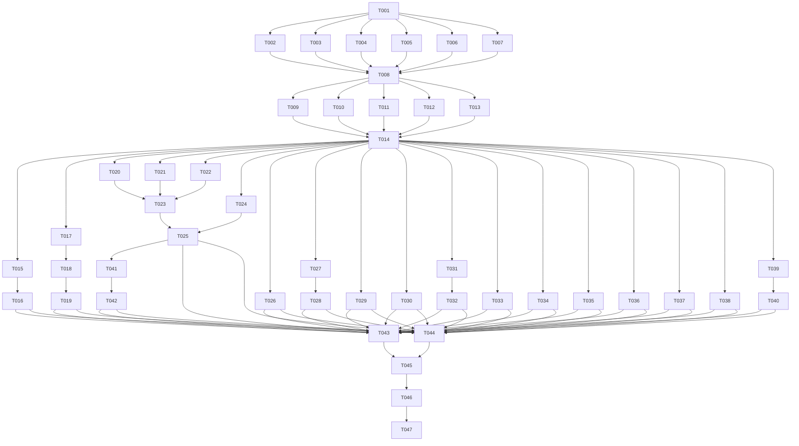

# Tasks: DS Bot HarmonyOS UI 层全量移植

**Input**: Design documents from `spec/dsbot-ui-port/`（spec.md、plan.md）
**Prerequisites**: plan.md (required), spec.md (required for user stories)

**Tests**: 本特性未要求测试任务与 TDD；验证以静态检查 + 构建为主（见 Verification 阶段）。

**Organization**: 任务按用户故事分组（US1–US11），每个故事可独立实现与独立验收；Setup/Foundational 为阻塞前置。

## Format: `[ID] [P?] [Story] Description`

- **[P]**: 可并行（不同文件、无未完成依赖）
- **[Story]**: 所属用户故事（US1–US11）
- 任务描述含确切文件路径

## Path Conventions

- 单工程：任务路径均相对 `entry/src/main/`（如 `ets/screens/Chat.ets`、`resources/base/profile/router_map.json`）；特别说明处使用完整路径
- 屏幕组件位于 `ets/screens/`，通用组件位于 `ets/components/`，唯一入口页位于 `ets/pages/Index.ets`（沿用 plan.md 现有工程架构，不新建分层）

---

## Phase 1: Setup（共享基础设施）

**Purpose**: 确认构建链路与页面注册配置

- [x] T001 确认构建配置：`resources/base/profile/main_pages.json` 注册 pages/Index、根目录与 entry 的 hvigorfile.ts 插件保持 `@ohos/hvigor-ohos-plugin`（已修复，不回退）、`module.json5` 权限与 `dsbot://pair` 深链 skill 配置完好

---

## Phase 2: Foundational（阻塞前置：存量修复 + 通用组件）

**Purpose**: 修复存量编译错误、创建全部屏幕依赖的通用组件与导航宿主

**⚠️ CRITICAL**: 本阶段完成前不得开始任何用户故事

- [x] T002 [P] 修复 AppStore 存量编译错误（any/unknown、SavedComputer null/undefined 不一致、解构声明、`setSystemIsZh` 导出缺失）in ets/appstate/AppStore.ets
- [x] T003 [P] 修复 Platform 存量编译错误（util.createRandom、userAuth/AuthTrustLevel、asset、webSocket API 误用）in ets/platform/Platform.ets
- [x] T004 [P] 修复 EntryAbility 存量编译错误（不存在的 AbilityConstantLauncher、深链常量）in ets/entryability/EntryAbility.ets
- [x] T005 [P] 修复 link 层存量编译错误（noise.ts 缺 NoiseIkSessionOptions、secure-transport.ts NoiseIkSession 不匹配、rpc-client.ts、keys.ts、frames.ts、pairing.ts、relay-transport.ts、transport.ts）in ets/common/link/
- [x] T006 [P] 修复 team 层存量编译错误（team-link.ts HandshakeHello/RpcClient 类型误用、chat-state.ts、store-core.ts、state-utils.ts、optimistic.ts）in ets/common/team/
- [x] T007 [P] 修复 demo 层存量编译错误（demo-link.ts、demo-team.ts 的 .ets 扩展导入）in ets/common/demo/
- [x] T008 运行 `arkts_check` 全项目检查，迭代修复直至存量约 85 处错误清零（仅修复，不新增功能、不重构 API）（依赖 T002–T007）
- [x] T009 [P] 创建主题 token 组件（调色板/圆角/排版，对齐 common/ui/tokens.ts + ThemeState 深浅色与团队强调色）in ets/components/Theme.ets
- [x] T010 [P] 创建 Sheet/SheetHeader 封装与 confirmDanger「再点一次」二次确认组件 in ets/components/Sheet.ets
- [x] T011 [P] 创建表单控件集（BackRow/Section/Row/Field/SwitchRow/Segmented/DangerRow/PickGrid）in ets/components/FormControls.ets
- [x] T012 [P] 创建头像组件（Avatar/RoomAvatar，shape/color/照片/主 Bot 标识，对齐 common/ui/characters）in ets/components/Marks.ets
- [x] T013 [P] 创建顶部通知横幅组件（提问/批准提醒、可关闭、点击跳转对应聊天、跟随横幅开关）in ets/components/Banner.ets
- [x] T014 创建唯一 @Entry 导航宿主（配对页 ↔ 主壳条件切换、Navigation+NavPathStack、抽屉骨架、深链配对覆盖层）in ets/pages/Index.ets；创建系统路由表 resources/base/profile/router_map.json 并在 module.json5 引用 routerMap（依赖 T008–T013）

**Checkpoint**: 存量错误清零、通用组件与导航宿主就绪，用户故事可开始

---

## Phase 3: User Story 1 - 启动与配对 (Priority: P1) 🎯 MVP

**Goal**: 无电脑时进入配对页；扫码/粘贴链接配对；`dsbot://pair` 深链冷/热启动拉起配对
**Independent Test**: 清除配对数据启动进入配对页；点「使用相机」拉起扫码；粘贴链接发起配对并看到成功/失败反馈

- [x] T015 [US1] 创建配对屏（指引文案、「使用相机」扫码入口、粘贴配对链接输入、「配对」按钮、成功保存电脑进入主界面、失败错误文案与重试）in ets/screens/Pair.ets 并注册路由
- [x] T016 [US1] 接线深链配对：EntryAbility onCreate/onNewWant 的 `dsbot://pair` → 宿主全局覆盖层任意屏幕拉起配对，取消回原界面（依赖 T015）in ets/pages/Index.ets 与 ets/entryability/EntryAbility.ets

**Checkpoint**: 配对闭环可用（需真实电脑端验收端到端；无电脑时验证屏幕与错误态）

---

## Phase 4: User Story 2 - 团队抽屉与导航壳 (Priority: P1)

**Goal**: 聊天为基座的主界面：抽屉（搜索/新建/团队列表/等你处理/设置）、Header、断线提示、上次聊天记忆
**Independent Test**: 已配对启动直进上次聊天；滑出抽屉看到完整团队列表与设置入口；上次聊天被删回退主 Bot

- [x] T017 [US2] 创建抽屉内容屏（「DS Bot」标题、搜索、新建菜单（创建新 Bot/创建群聊）、「等你处理」行+数量角标、Bot 与群聊列表（头像/名称/预览/未读）、设置入口、空团队引导）in ets/screens/TeamList.ets
- [x] T018 [US2] 实现抽屉交互（Stack 侧滑面板、手势开关、遮罩点击关闭、连接中/正在重新连接提示条与「电脑」设置跳转）in ets/pages/Index.ets（依赖 T017）
- [x] T019 [US2] 实现聊天基座 Header（当前聊天标题 pill 进详情、菜单按钮待办红点、旁聊按钮、断线提示）与上次聊天记忆（`dsbot.lastChat` 语义）及删除回退主 Bot in ets/pages/Index.ets 与 ets/appstate/AppStore.ets（依赖 T017、T018）

**Checkpoint**: 导航壳完整，可进入各聊天

---

## Phase 5: User Story 3 - 聊天 (Priority: P1)

**Goal**: 全部消息类型渲染、发送文本/照片、乐观发送与重试、历史分页、停止 Bot、横幅提醒
**Independent Test**: 打开 Bot 聊天发送消息收到 markdown 回复；发照片；上滑看历史；工作中点停止

- [x] T020 [P] [US3] 创建 markdown 气泡渲染组件（粗体/列表/代码块/表格/公式，经 common/markdown 与 formula 解析）in ets/screens/chat/MarkdownText.ets；创建 deep view 固定格式渲染组件（深度/大小上限、不执行脚本不访问网络）in ets/screens/chat/DeepView.ets
- [x] T021 [P] [US3] 创建消息行组件（事件行/步骤行（工具调用、思考时长）/轮次分隔/用户消息含照片/图片消息本地先显）in ets/screens/chat/ChatRows.ets
- [x] T022 [P] [US3] 创建聊天卡片组件（提问卡（选项/多选/自定义）、批准卡（允许/拒绝）、密钥请求卡（值不回显）、浏览器交接卡（去接管），就地操作）in ets/screens/chat/ChatCards.ets
- [x] T023 [US3] 创建消息列表（List+LazyForEach、上滑分页加载更早消息、新消息滚到底）in ets/screens/chat/MessageList.ets（依赖 T020–T022）
- [x] T024 [US3] 创建输入区（文本发送、添加照片（相册选择、压缩长边 2048）、乐观发送中/失败态与点按重试、Bot 工作中显示「停止」按钮）in ets/screens/chat/ChatInput.ets
- [x] T025 [US3] 组装聊天屏（私聊/群聊、接入 Header、MessageList、ChatInput、横幅联动、长按复制）in ets/screens/Chat.ets 并注册路由（依赖 T023、T024）

**Checkpoint**: 聊天核心闭环可用（US1–US3 构成 MVP）

---

## Phase 6: User Story 4 - 等你处理 (Priority: P2)

**Goal**: 全部待办分类聚合、就地作答、跳转、关闭态与空态
**Independent Test**: 电脑端发起提问后打开「等你处理」看到并就地作答，列表实时更新

- [x] T026 [US4] 创建等你处理面板（提问/批准/密钥/卡片/浏览器交接分类分栏、来源与摘要、就地快速作答（回答/允许/拒绝/填密钥）、点击跳转对应聊天、已关闭态「这项批准已经关闭了」、空态「没有要等你的事」）in ets/screens/NeedsYou.ets 并注册路由

---

## Phase 7: User Story 5 - Bot 详情、编辑与新建 (Priority: P2)

**Goal**: Bot 详情/编辑/新建、群聊新建、复制/删除二次确认
**Independent Test**: Header pill 进详情；编辑改名同步；抽屉新建菜单创建新 Bot；新建群聊成员不足 2 提示

- [x] T027 [P] [US5] 创建模型菜单/选择器组件（模型与强度选择、管理服务商入口）in ets/screens/ModelMenu.ets
- [x] T028 [US5] 创建 Bot 详情屏（头像/名称/角色/主 Bot 标识、模型（ModelMenu）、状态阻塞提示、工作文件夹入口、指令、记忆/用量/日程入口、浏览器 Tab、操作（发消息/编辑/复制/删除「再点一次删除这个 Bot」））in ets/screens/BotDetails.ets 并注册路由（依赖 T027）
- [x] T029 [P] [US5] 创建 Bot 编辑屏（资料（名字/标签）、形象 PickGrid、颜色、头像照片上传与移除、指令、隐私开关及说明、权限预设、能力开关、复制、删除二次确认）in ets/screens/BotEdit.ets 并注册路由
- [x] T030 [P] [US5] 创建新建屏（新建 Bot：名字/形象/指令/模型；新建群聊：成员多选、管理员、至少 2 个成员校验提示、共享指令、谁来回答（管理员主导/全体轮流））in ets/screens/NewChat.ets 并注册路由

---

## Phase 8: User Story 6 - 群聊详情与设置 (Priority: P2)

**Goal**: 群详情与群设置（成员/公告/谁来回答/删除）
**Independent Test**: 群聊 Header pill 进群详情；修改「谁来回答」保存；删除群聊两次确认

- [x] T031 [P] [US6] 创建群详情屏（成员列表（数量/管理员标识/头像堆叠）、公告、共享指令、谁来回答、记忆入口、成员点击进 Bot 详情）in ets/screens/GroupDetails.ets 并注册路由
- [x] T032 [US6] 创建群设置屏（成员勾选增删、设为管理员、公告编辑、谁来回答切换、删除群聊二次确认）in ets/screens/GroupSettings.ets 并注册路由

---

## Phase 9: User Story 7 - 记忆、日程、文件夹、用量 (Priority: P2)

**Goal**: Bot/群详情的四个子页
**Independent Test**: 详情进记忆页添加条目；日程页新建每天任务；文件夹页选择文件夹；用量页显示今日数据

- [x] T033 [P] [US7] 创建记忆屏（条目列表（范围/主题/内容）、问记忆、添加（范围/主题/内容）、编辑、移除二次确认）in ets/screens/Memory.ets 并注册路由
- [x] T034 [P] [US7] 创建日程屏（任务列表（频率中文描述/下次执行时间）、新建（标题/提示语/频率：一次/每天/每周/重复）、删除）in ets/screens/Schedules.ets 并注册路由
- [x] T035 [P] [US7] 创建文件夹选择屏（文件夹层级导航（上一级/进入/使用此文件夹）、路径直接输入、团队工作区）in ets/screens/Folder.ets 并注册路由
- [x] T036 [P] [US7] 创建用量屏（日/周/月 Tokens 输入/输出与运行次数）in ets/screens/Usage.ets 并注册路由

---

## Phase 10: User Story 8 - 旁聊 Side (Priority: P2)

**Goal**: Bot 工作时旁问通道
**Independent Test**: Bot 工作中打开旁聊提问，见「正在回答…」→ 回答；取消显示已取消

- [x] T037 [US8] 创建旁聊屏（Header 旁聊按钮入口（有活动会话的 Bot）、提问、正在回答…与取消、回答附「按目前的进展回答；没有运行任何东西」说明、历史旁聊列表）in ets/screens/Side.ets 并注册路由

---

## Phase 11: User Story 9 - Bot 浏览器 (Priority: P2)

**Goal**: 查看浏览器截图、接管/交还/停止、回应等待卡
**Independent Test**: Bot 打开浏览器后进 Bot 浏览器页见画面并接管/交还；无浏览器显示空态

- [x] T038 [US9] 创建 Bot 浏览器屏（`browser-frame` 2 秒截图轮询→base64 解码 PixelMap 渲染、title/url 展示、`browser-takeover`/`browser-give-back`（outcome=done|skip+callId）/`browser-stop`、browserHolds 状态与 note、`bot/not-found` 显示「这个 Bot 没有打开的浏览器」、浏览器交接卡回应）in ets/screens/BotBrowser.ets 并注册路由

---

## Phase 12: User Story 10 - 设置全套 (Priority: P2)

**Goal**: 全部设置页与高权限解锁
**Independent Test**: 设置切深色即时生效；电脑列表忘记（二次确认）；密钥新增触发生物识别解锁；未设屏幕锁给指引

- [x] T039 [US10] 创建设置面板（面板形式入口列表 + Done 关闭：外观、语言、应用内横幅、电脑、密钥、模型服务商、连接器、能力、团队用量、位置、更新和诊断、关于）in ets/screens/Settings.ets 并注册路由
- [x] T040 [US10] 创建设置子页（外观（跟随系统/浅色/深色）、语言（跟随系统/中文/English 即时生效）、横幅开关、电脑列表（在线状态/切换/忘记二次确认/添加）、密钥（列表/新增/更新/删除）、模型服务商（列表/添加已知或自定义/移除/填 key/查找模型）、连接器（状态/连接/断开/重试/令牌）、能力（MCP/技能/套件/本地命令：查看/保存/批准/删除）、团队用量、位置、更新和诊断（检查更新/诊断日志查看/清除/复制）、关于；密钥/服务商 key/连接器/能力/更新等高权限操作先经生物识别解锁，`unlock/canceled` 静默，未设屏幕锁提示「请先给这台手机设一个屏幕锁」）in ets/screens/SettingsPages.ets 并注册路由（依赖 T039）

---

## Phase 13: User Story 11 - 主题、i18n 与全局体验 (Priority: P2)

**Goal**: 深浅色与团队强调色、zh/en 即时切换、触感、复制、统一确认与反馈态
**Independent Test**: 切系统深浅色界面跟随；团队强调色跟随；中文日期格式；长按消息复制

- [x] T041 [US11] 主题联动：本机外观偏好 + 跟随电脑团队主题/强调色、语言切换即时生效且持久化（系统深浅色监听、Prefs 落地）in ets/components/Theme.ets、ets/appstate/AppStore.ets、ets/pages/Index.ets
- [x] T042 [US11] 全局体验收口：中英文日期时间格式（如「11月15日」）、发送成功/危险操作触感反馈（Platform haptics）、长按消息复制到剪贴板、等待加载态与错误态全屏反馈、全部文案经 i18n 无硬编码 in 相关 ets/screens/* 与 ets/components/*（依赖 T041）

---

## Phase 14: Polish（横切收尾）

- [x] T043 核对路由表与屏幕一致：router_map.json 全量注册、单 @Entry、各屏 NavDestination 为根、$r 资源引用有效 in resources/base/profile/router_map.json 与 ets/screens/*
- [x] T044 确认演示入口不可达（DemoLink/DemoTeam 代码保留但 UI 无入口）并清理未用导出与死代码 in ets/ 全局
- [x] T045 全项目 `arkts_check` 静态检查（含新增 UI 代码）迭代修复至清零（依赖 T043、T044）

---

## Phase 15: Verification

<!-- verification_scope: build-only -->

**Purpose**: 构建、部署验证（本阶段任务不带 [USx] 标签；无 UI 验证任务）

- [x] T046 构建并修复全部编译错误（调用 `devecocli build`，迭代 修复→构建 直至成功产出 HAP）（依赖 T045）
- [x] T047 部署应用到设备/模拟器（调用 `devecocli run --skip-build`；无可用设备时记录说明并保留构建产物验证结论）（依赖 T046）

---

## 📊 Dependency Graph



## ⚡ Parallel Execution Guide

| Phase | Tasks | Required Files | Execution Notes |
|-------|-------|----------------|-----------------|
| Setup | T001 | main_pages.json、hvigorfile.ts、module.json5 | 确认性任务，先行 |
| Foundational-修复 | T002–T007 | AppStore.ets、Platform.ets、EntryAbility.ets、common/link、common/team、common/demo | 六组文件互不重叠，可全并行 |
| Foundational-验证 | T008 | 全项目 | 等待 T002–T007 后串行 |
| Foundational-组件 | T009–T013 | components/Theme、Sheet、FormControls、Marks、Banner | 五个新文件可全并行 |
| US1 | T015 → T016 | screens/Pair.ets、pages/Index.ets | 串行 |
| US2 | T017 → T018 → T019 | screens/TeamList.ets、pages/Index.ets | 串行（同宿主文件） |
| US3 | T020、T021、T022 并行 → T023；T024 独立 → T025 | screens/chat/* | chat 子组件并行，组装串行 |
| US4 | T026 | screens/NeedsYou.ets | 独立 |
| US5 | T027 → T028；T029、T030 并行 | screens/ModelMenu、BotDetails、BotEdit、NewChat | 两支可并行 |
| US6 | T031 → T032 | screens/GroupDetails、GroupSettings | 串行 |
| US7 | T033–T036 | screens/Memory、Schedules、Folder、Usage | 四屏全并行 |
| US8 | T037 | screens/Side.ets | 独立 |
| US9 | T038 | screens/BotBrowser.ets | 独立 |
| US10 | T039 → T040 | screens/Settings、SettingsPages | 串行 |
| US11 | T041 → T042 | Theme.ets、AppStore.ets、Index.ets、screens/* | 主题先行，体验收口在后 |
| Polish | T043、T044 并行 → T045 | router_map.json、ets/ 全局 | 全部故事完成后 |
| Verification | T046 → T047 | 全项目 | 构建通过后部署 |

## Dependencies & Execution Order

### Phase Dependencies

- **Setup (Phase 1)**: 无依赖，立即开始
- **Foundational (Phase 2)**: 依赖 Setup 完成 —— 阻塞全部用户故事
- **User Stories (Phase 3–13)**: 全部依赖 Foundational（T014 宿主就绪）
  - 故事间按优先级串行推进（P1 → P2），或按并行指南多线推进
- **Polish (Phase 14)**: 依赖全部目标故事完成
- **Verification (Phase 15)**: 依赖 Polish 完成

### User Story Dependencies

- **US1/US2/US3 (P1)**: 依赖 T014；US2 的 T019 与 US3 的 T025 共享宿主 Header 接线，按 T019 → T025 顺序执行
- **US4–US10 (P2)**: 依赖 T014，故事间相互独立，可并行
- **US11 (P2)**: T041 建议在 T025（聊天屏就绪）后执行以便全屏验证主题

### Within Each User Story

- 组件先行（models/components），组装在后（组装任务均标注依赖）
- 核心实现优先于集成接线
- 每个故事完成后在其 Checkpoint 独立验收

## Parallel Example: User Story 3（聊天）

```text
# 同时启动三个独立渲染组件（不同文件、仅依赖 T014）：
Task: "T020 [P] [US3] MarkdownText.ets + DeepView.ets"
Task: "T021 [P] [US3] ChatRows.ets"
Task: "T022 [P] [US3] ChatCards.ets"
# 汇合后串行组装：
Task: "T023 [US3] MessageList.ets（依赖 T020–T022）"
Task: "T025 [US3] Chat.ets（依赖 T023、T024）"
```

## Implementation Strategy

### MVP First（User Story 1–3）

1. 完成 Phase 1: Setup
2. 完成 Phase 2: Foundational（CRITICAL —— 阻塞全部故事）
3. 完成 US1（配对）+ US2（导航壳）+ US3（聊天）
4. **STOP and VALIDATE**: 构建验证 MVP（配对 → 团队列表 → 聊天 闭环）
5. 可部署演示

### Incremental Delivery

1. Setup + Foundational → 基础就绪
2. US1 → 独立验收 → US2 → 独立验收 → US3 → MVP 验收/部署
3. US4 → US5 → … → US10 → US11，逐故事独立验收
4. Polish → Verification → 最终构建/部署

---

## Notes

- [P] 任务 = 不同文件、无未完成依赖
- [Story] 标签将任务映射到 spec.md 用户故事，保证可追溯
- 每个用户故事可独立完成、独立验收（Independent Test 见各阶段）
- Verification 范围为 build-only（用户已在验证选项门选定「仅运行验证」），不含 UI 验证任务
- 无真实电脑环境时，配对/聊天端到端闭环无法在本机完整验收，以构建通过 + 屏幕代码完成为替代验收
- 每个任务或逻辑组完成后提交（如启用 git）
- 可在任意 Checkpoint 停下做独立验收

## Summary Report

- **总任务数**: 47（T001–T047）
- **按故事分布**: Setup 1、Foundational 13、US1 2、US2 3、US3 6、US4 1、US5 4、US6 2、US7 4、US8 1、US9 1、US10 2、US11 2、Polish 3、Verification 2
- **并行机会**: 存量修复 6 组全并行（T002–T007）、通用组件 5 个全并行（T009–T013）、聊天子组件 3 个并行（T020–T022）、US5 两支并行、US7 四屏全并行
- **独立验收**: 每个用户故事均有 Independent Test；US1–US3 构成 MVP 闭环（配对 → 团队列表 → 聊天）
- **建议 MVP 范围**: T001–T025（Setup + Foundational + US1 + US2 + US3）
- **验证范围**: build-only（T046 构建 + T047 部署；无 UI 验证任务）
